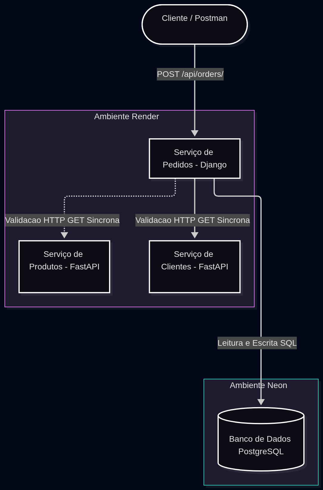

# Sistema de Pedidos de E-commerce Simplificado

Repositório do projeto da disciplina de Sistemas Distribuídos - 3ª Unidade.

## Módulo 1: Computação em Nuvem

**Acesso à API Pública:** [https://ecommerce-sd.onrender.com/api/orders/](https://ecommerce-sd.onrender.com/api/orders/)

### Links dos Vídeos de Demonstração
- **Demonstrações (Pasta do Drive):** [Acessar os vídeos do Mateus e do Diego](https://drive.google.com/drive/folders/1lScf9nFotYTD9e5TKSHH85W4c8RrAlvt?usp=sharing)

### Justificativa Técnica (Arquitetura)
Para a primeira etapa do projeto, adotamos a seguinte arquitetura em nuvem:
- **Aplicação (PaaS):** Utilizamos o **Render** para hospedar nossa API REST em Django. O Render permite deploy direto do código-fonte no GitHub e facilita a configuração das variáveis de ambiente (`DATABASE_URL`, `SECRET_KEY`, `ALLOWED_HOSTS`), mantendo as credenciais seguras e fora do código-fonte.
- **Banco de Dados (DBaaS):** Utilizamos o **Neon** para o banco de dados PostgreSQL em nuvem. Ele oferece instâncias *serverless* rápidas de configurar e nos fornece uma *Connection String* simples para integrar com a nossa aplicação no Render de forma completamente isolada.

### Como executar o projeto localmente
1. Clone o repositório e acesse a pasta:
   ```bash
   git clone https://github.com/M2004GV/ecommerce-sd.git
   cd ecommerce-sd
   
## Módulo 2: Arquitetura de Microsserviços e Comunicação Síncrona

### Diagrama da Arquitetura
Refatoramos o projeto para a arquitetura de microsserviços utilizando a estratégia de *monorepo* (uma pasta para cada serviço).


### Links dos Serviços Públicos (Render)
- **Serviço de Pedidos (Django):** [https://ecommerce-sd.onrender.com/api/orders/](https://ecommerce-sd.onrender.com/api/orders/)
- **Serviço de Clientes (FastAPI):** [https://servico-clientes.onrender.com]
- **Serviço de Produtos (FastAPI):** [https://servico-produtos.onrender.com]

### Como testar a comunicação entre os serviços
A comunicação entre os microsserviços ocorre de forma síncrona via requisições HTTP REST. Quando um pedido é feito, o Serviço de Pedidos consulta o Serviço de Clientes na nuvem.

**1. Testando o Caminho de Sucesso:**
1. Acesse o link do Serviço de Pedidos acima.
2. Desça até a seção de POST, clique na aba **"Raw data"** e envie o JSON abaixo (utilizando o `cliente_id: 1` que existe no nosso serviço):
   ```json
   {
       "customer_name": "Teste de Sucesso",
       "status": "PENDING",
       "cliente_id": 1
   }